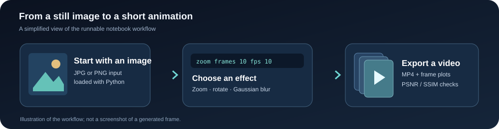
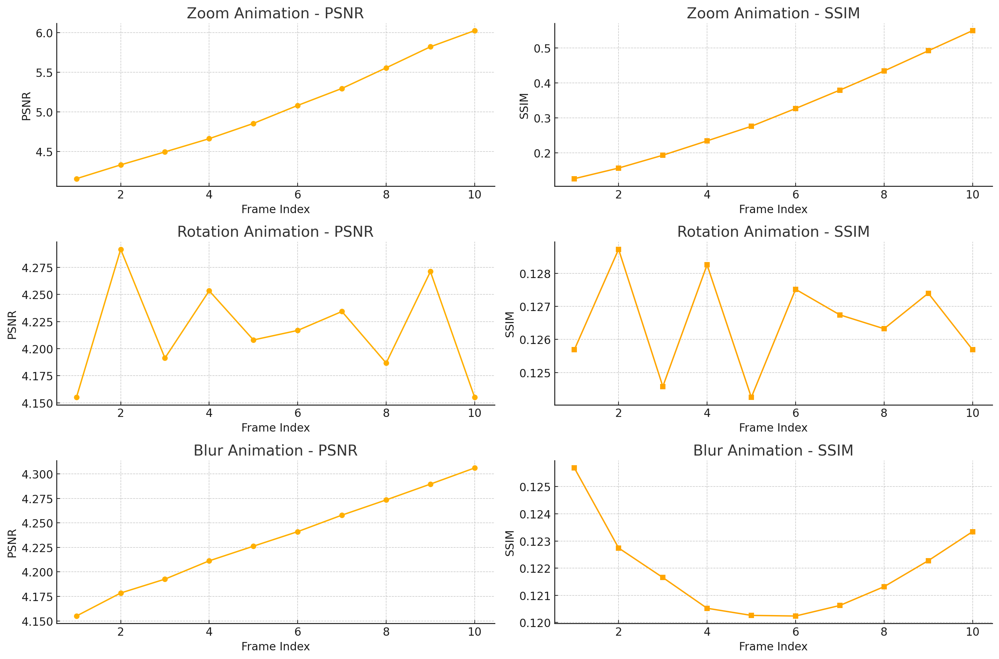

# Real-Time Motion Synthesis

*Making a still image move, one frame at a time.*

I started this project with a simple question: **could I describe an animation in plain English and have a program build it from a single image?** The result is a notebook that takes a photo, creates zoom, rotation, or blur effects frame by frame, and saves the animation as a video.

It's a small research prototype rather than a full text-to-video model. What interested me most was connecting an intuitive, text-based interface with the actual image transformations—and then looking at how the generated frames changed over time.



## See it in action

The repository includes a few videos generated during development:

| Demo | What you'll see |
| --- | --- |
| **[Watch the zoom animation](zoom_animation.mp4)** | A still image gradually zooming toward its center |
| **[Watch another zoom example](zoom_effect.mp4)** | A separate output from the frame-generation experiments |
| **[Watch the earlier animation demo](output_animation.mp4)** | Output from an earlier version of the pipeline |

These links open the real MP4 files in the repository, not mockups.

### One image, a few different effects

The interactive version understands simple effect names. For example:

| Type this | What happens |
| --- | --- |
| `zoom frames 10 fps 10` | Creates 10 progressively zoomed-in frames, saved at 10 FPS |
| `rotate frames 10 fps 10` | Rotates the image across 10 frames |
| `blur frames 10 fps 10` | Gradually increases Gaussian blur |

Here's the basic idea behind the zoom effect: the image is resized a little more for each frame, then center-cropped back to its original dimensions. Rotation uses an affine transformation; blur changes the Gaussian kernel size between frames.

## What I measured

Generating a video is one part of the project. I also wanted to see what was happening *between* the frames.

The notebook includes plots of **PSNR** and **SSIM**, along with exploratory pixel histograms and frame-to-frame differences. The image below is an output saved from those experiments:



One thing worth noting: PSNR and SSIM are calculated against the **original still image**. They tell us how much a transformed frame resembles the starting image; they do **not** measure whether an animation has realistic motion. A large zoom can be exactly what the user requested and still lower those similarity scores.

## How the notebook is put together

Most of the work happens in four parts:

1. **Read the image.** Load a JPG/PNG image with Pillow or OpenCV and prepare it as an array.
2. **Read the command.** The final interactive cell detects keywords such as `zoom`, `rotate`, and `blur`, with optional frame-count and FPS values.
3. **Build the frames.** NumPy and OpenCV apply progressive transformations to the input image.
4. **Save and inspect.** OpenCV writes an MP4, and the notebook plots frame-level measurements.

The notebook also contains **earlier experiments with Hugging Face GPT-2 and a Vision Transformer (ViT)**. Those were attempts to explore model-assisted interpretation and visual features. The **final interactive animation cell uses a simpler keyword-based parser**; it does not depend on a running transformer to generate its frames.

## Try it yourself

The code is in **[`main.ipynb`](main.ipynb)**. You'll need Python 3 and a notebook environment such as Jupyter.

**1. Clone the repository**

```bash
git clone https://github.com/kvkarthikeya/Real-time-Motion-Synthesis.git
cd Real-time-Motion-Synthesis
```

**2. Install the packages used by the OpenCV workflow**

```bash
python -m pip install numpy opencv-python pillow matplotlib scikit-image tqdm psutil notebook
```

The earlier GPT-2 / ViT experiments additionally use `transformers` and `torch`. They aren't needed for the final OpenCV animation cell, and their older code may need updates for current library versions.

**3. Add an input image**

Place an image named `image.jpg` in the notebook's working directory, or edit the `input_image_path` variable to point to a local file. An input image is **not** included in this repository.

**4. Open and run the notebook**

```bash
jupyter notebook main.ipynb
```

The notebook preserves several iterations of the experiment, so **you don't need to run every cell in order**. Start with the last complete interactive animation cell, install any missing packages, and try:

```text
zoom frames 10 fps 10
```

The program displays the frames and evaluation plots and writes a file such as `zoom_animation.mp4`.

**A couple of quirks to know:** The small command parser currently looks for a number *after* the words `frames` and `fps` (rather than understanding every possible English sentence). Its defaults are 10 frames and 10 FPS. The display code also uses a fixed 2×5 grid, so stick with **10 frames** unless you update that plotting section. On newer versions of `scikit-image`, you may need to replace `multichannel=True` with `channel_axis=-1` in the SSIM call.

## Tools used

| Part | Library / approach |
| --- | --- |
| Image transformations | OpenCV, NumPy |
| Reading images | Pillow / OpenCV |
| Interactive commands | Simple keyword matching in the final version |
| Exploratory language-model work | Hugging Face GPT-2 |
| Exploratory vision-model work | Vision Transformer (ViT) |
| Analysis | Matplotlib, scikit-image (PSNR / SSIM) |
| Video export | OpenCV `VideoWriter` |

## What I'd like to improve

This is still a notebook-first prototype. In a future version, I'd like to separate the experiments from the runnable pipeline, make command parsing more flexible, add proper tests, and evaluate temporal consistency more directly. Learned motion and scene-aware animation would be a much larger next step; the current system uses **2D transformations**, not a trained video diffusion model or 3D motion generator.

The project started as an exploration of text-guided image animation and was written up for a CVPR 2025 submission. The public repository contains the experimental implementation; **a submission is not a claim of conference acceptance**.

---

Built by [KV Karthikeya](https://github.com/kvkarthikeya). If you explore the notebook, the [saved demos](zoom_animation.mp4) are a good place to start.
